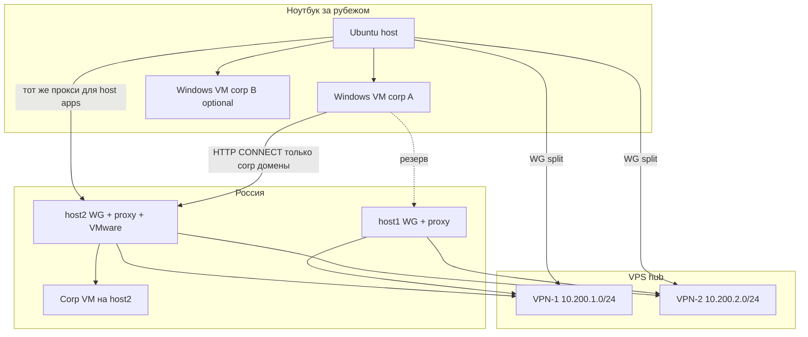

# Целевая архитектура (историческая: corp split)

> **Актуально для походного ноутбука (2026-10-26):** см. **`LAPTOP-GW-ARCHITECTURE.md`**, **`AGENT-LAPTOP.md`**.  
> Ниже — прежняя схема «split WG + corp HTTP proxy на Home-3».

## Участники

## Принципы

1. **Split tunnel WireGuard:** в клиенте `AllowedIPs` только `10.200.1.0/24` и `10.200.2.0/24`, не `0.0.0.0/0`.
2. **Корп. L7:** список доменов как на host2 (3proxy ACL) — трафик к ним **только** через `http://10.200.x.2:3128` (или host1).
3. **Corp VPN внутри VM** (Check Point, Rutoken) — отдельный канал; не смешивать с «обходом» через RF для Sfera/Basis, если политика разделяет контуры.
4. **Два VPS** — резерв **доступности hub’а**, не сквозная маршрутизация между `.1.0/24` и `.2.0/24`.

## VMware на host2 (эталон)

| NIC | Режим | Назначение |
|-----|--------|------------|
| NIC1 | NAT / isolated | Corp VPN в госте |
| NIC2 | Host-only VMnet8 `192.168.136.0/24` | host2 ↔ VM, corp-proxy :3332 |

На **ноутбуке** — та же логика: corp tunnel в guest, выход на `*.vtb.ru` / `*.inno.local` через WG → RF proxy.

## VMware на ноутбуке (план)

- Не bridged в домашний Wi‑Fi, если рядом corp VPN и split-маршруты.
- Проброс USB Rutoken — в ту VM, где нужен cvpn; при смене VM — переподключение устройства (как на host2).

## Проверки

| Проверка | Ожидание |
|----------|----------|
| `ping 10.200.1.1` с ноутбука | OK при поднятом vpn1 |
| `curl -x http://10.200.1.2:3128 -I https://…corp…` | 200/302 через цепочку |
| `curl` без прокси на corp URL | **не** должен идти напрямую, если политика «strict» |
| `wg show` | latest handshake, received > 0 |

## Dual hub на клиенте

Два туннеля одновременно (как host2): прокси можно выбрать по доступности (`10.200.1.2` vs `10.200.2.2`); PAC с fallback — отдельная задача.
